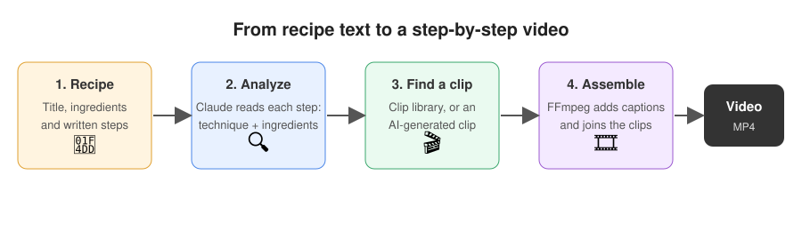
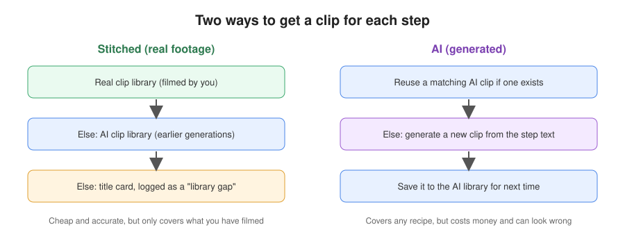

# Cooking: recipe to step-by-step video

Recipe sites list ingredients and steps but rarely show the technique. This project turns a written recipe
into a short step-by-step tutorial video: one clip per step, with a caption, joined into a single MP4.
People post recipes, and the platform generates the video and lets others browse them.

## Two strategies, compared side by side
The MVP builds each recipe's video two ways so you can decide which to invest in. A review page shows both
videos next to each other with cost and render time, and lets you score each step for technique, ingredients
and clarity.

The **clip library** is a table of short clips tagged by technique (such as `dice` or `sear`) and ingredient.
You upload real footage at `/admin/clips`, and AI-generated clips are saved to it automatically. Steps that
find no clip are listed as library gaps, which tells you what to film next.

**Status:** MVP. AI clips come from a mock generator; a real video provider is not connected yet.

---

See the plan in `~/.claude/plans/` for architecture. Layout:

- `apps/web` Next.js app and Prisma schema (`prisma/schema.prisma`)
- `worker` Python video pipeline (FFmpeg, `ClipGenerator` adapters)
- `infra` docker-compose for Postgres, Redis, SeaweedFS

## Prereqs
Node 20+, Docker, FFmpeg, Python 3.9+.

## Start
    cp .env.example .env
    docker compose -f infra/docker-compose.yml up -d
    cd worker && python3 -m venv .venv && . .venv/bin/activate && pip install -r requirements.txt && pytest

## Run
    docker compose -f infra/docker-compose.yml up -d
    cd apps/web && npm install && npx prisma migrate dev && npx tsx prisma/seed.ts && npm run dev
    # in another terminal:
    cd worker && . .venv/bin/activate && python main.py   # renders queued videos

The web app creates `Video` rows with status `queued`; the worker polls Postgres,
renders them with FFmpeg, uploads to the S3 store, and sets `done` or `failed`.
